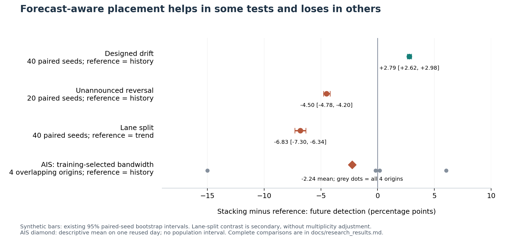
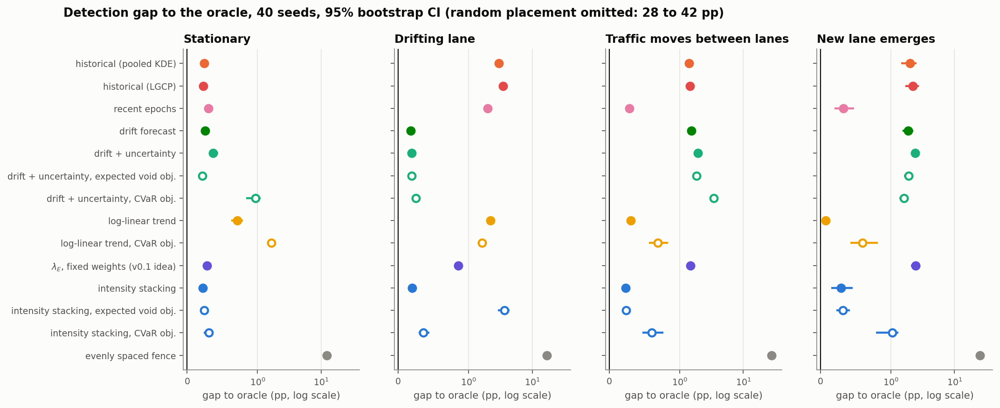
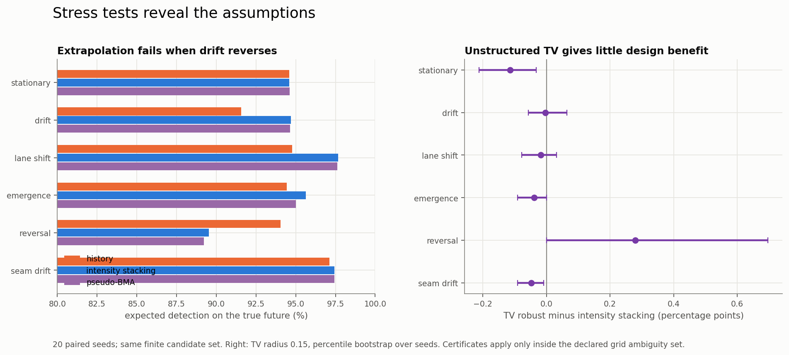
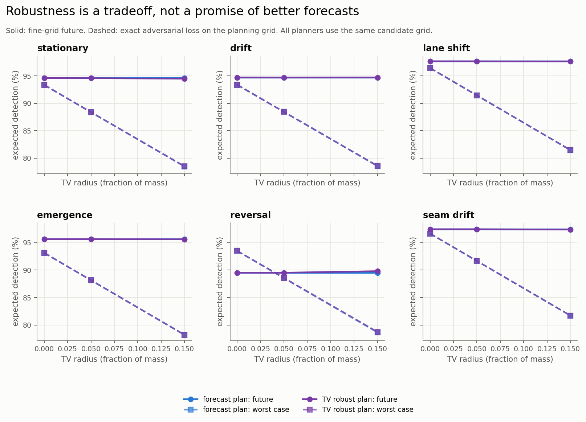
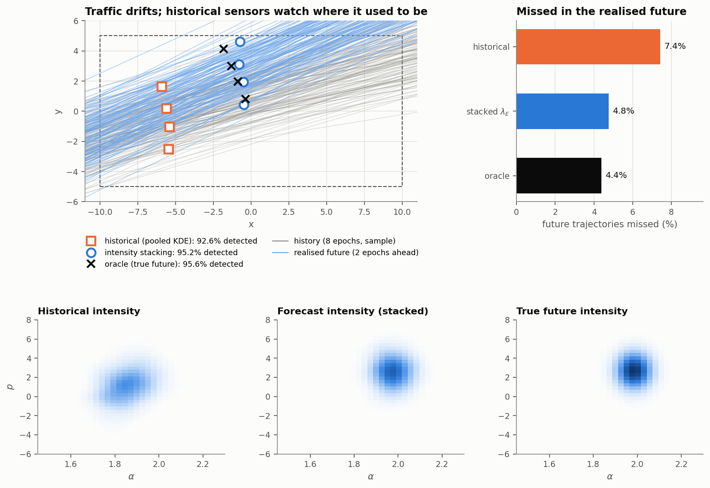
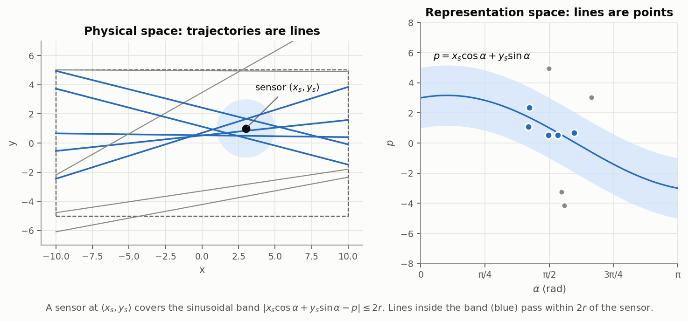

# When does forecast-aware sensor placement help?

[](https://github.com/Zahir-Hossain/stochastic-sensor-placement-extension/actions/workflows/ci.yml?query=branch%3Amain)


[](https://arxiv.org/abs/2505.00825)

`stochplace` is a Python package and reproducible stress test of fixed sensor
placement under changing traffic, using synthetic line trajectories and
public AIS ship tracks.

**Forecast-aware placement helps when a candidate captures the shift.
It loses to history under an unannounced reversal and on average in this
one-day AIS reanalysis.** Combining forecasts also loses to individual
components in the additional synthetic tests.



*The reference method is named on every row. Synthetic intervals resample
paired seeds; the lane-split component comparison is secondary and has no
multiplicity adjustment. The AIS mean and all four overlapping origins are
descriptive, with no population interval. These are modelled detection
probabilities, not measurements from deployed sensors. [Source data](docs/figures/research_overview_data.csv).*

<!-- at-a-glance:start -->
| Evidence | Result |
|---|---|
| Three designed shifts matching a candidate (40 seeds each) | 32.8-37.6% fewer expected misses than historical planning |
| Five shifts outside the candidate families (40 seeds each) | Higher mean detection than history in 5/5; lower mean than the best single component in 5/5, by up to 6.83 pp |
| Unannounced drift reversal (20 seeds) | Stacking minus history: -4.50 pp detection |
| One AIS day, four overlapping origins | Training-selected history 84.78%; stacking 82.55%. Stacking is ahead at 2/4 origins |
| Transport ambiguity (20 seeds per regime) | Lower mean future detection in 6/6 regimes under the fixed radius-calibration rule |
| Frozen sampler gate | 0/2 alternative samplers eligible; current component sampler also fails |
<!-- at-a-glance:end -->

Generated from saved runs by `python scripts/presentation_summary.py`.
The best-component comparison is descriptive; [all methods and intervals](docs/tables/holdout_components.md)
remain visible. The AIS bandwidth grid hits its lower edge at every selection.

**Start here:** [run the package](START_HERE.md), read the
[technical report](paper/main.pdf), inspect the [complete results](docs/research_results.md),
or check the [current validation](docs/validation.md).

## What this repository adds

- Chronological combination of line-intensity forecasts by held-out Poisson
  score, followed by sensor placement against the combined intensity.
- Stress tests with known future truth, a frozen sampler gate, AIS controls,
  and both TV and line-space transport ambiguity studies.
- Raw runs, source fingerprints, independent numerical checks and a workflow
  that reproduces the successful and unsuccessful cases.

The extension design was frozen before its outcomes in the preserved local
history; there is no external preregistration timestamp. The line
representation, LGCP, stacking, CVaR and Wasserstein duality are established
methods. [Attribution and research boundary](docs/research_boundary.md).

## What did not work

- Combining forecasts does not beat the strongest individual component in
  mean detection in any of the five additional shift regimes.
- Expected-void planning on the stacked forecast is worse than expected-miss
  planning under drift. Its lower mean than historical planning has a paired
  interval that includes zero.
- TV ambiguity barely changes future detection. Transport ambiguity lowers
  it under the fixed calibration rule, whose first prefix uses pooled history.
- The current sampler and both alternatives fail the frozen calibration gate;
  sample-based void and CVaR comparisons remain sensitivity analyses.
- Real-data evidence covers one previously viewed AIS day. The multi-week
  study remains [blocked by archive access](docs/data_access.md).

## Detailed extension findings

<!-- extension-summary:start -->
C1 gains against pooled history do not establish superiority to individual components; the full paired comparisons include component wins. On the reused AIS day, training-selected historical KDE averages 84.78% detection versus 82.55% for training-selected stacking. Stacking exceeds history at 2/4 origins; the mean gap is driven by origin 7. The geometry-aware transport plan reduces mean future detection in 6/6 tested regimes under the fixed calibration rule, which can be driven by pooled-history backtests. This does not isolate the effect of geometry. Both sampler candidates fail their frozen eligibility gate. No experimental method or bandwidth setting is adopted.
<!-- extension-summary:end -->

Reproduce the extension with `python scripts/reproduce_extensions.py --workers 8`.
Specialized runner configs are in `configs/research/`; ordinary synthetic
experiment configs remain in `configs/`.

## Findings, including the failures

The main synthetic comparison uses 40 paired seeds per scenario, eight
observed epochs, four sensors, and a two-epoch forecast horizon. Placements
are evaluated on true future intensity on a finer grid. Intervals below
are percentile bootstrap intervals over seeds for the relative reduction
in expected misses.

<!-- headline:start -->
| Scenario | Historical misses | Intensity-stacking misses | Relative miss reduction [95% CI] |
|---|---:|---:|---:|
| Stationary | 3.42% | 3.41% | 0.5% [-0.2, 1.5] |
| Drifting lane | 7.41% | 4.62% | 37.6% [36.1, 39.1] |
| Lane shift | 3.20% | 2.04% | 36.3% [34.7, 37.8] |
| Emerging lane | 5.15% | 3.46% | 32.8% [24.8, 39.2] |
<!-- headline:end -->

These are designed scenarios, not an estimate of improvement in all real
traffic. Each successful shifting regime closely matches a candidate:
constant-velocity motion matches the drift forecaster, logit-linear lane
shares resemble the log-linear trend model, and stationary traffic matches
pooled history. The headline gains show that held-out scoring can select a
well-specified candidate; they do not establish performance under shifts
outside all candidate families. The unannounced reversal is such a stress
case, and stacking loses to history there.

A relative reduction in misses is different from a percentage-point
increase in detection rate. See the [complete strategy table](docs/tables/suite.md).

**Expected-void planning also fails under drift.** On the component-sampled
stacked forecast, it detects less future traffic than historical planning
on average in these runs. The paired interval includes zero.

<!-- void-failure:start -->
Gap to the true-intensity heuristic: **3.67 [2.90, 4.44] pp**; 29 of 40 seeds exceed 1 pp. Correlation with non-drift component weight: 0.70. Detection difference from history: **-0.69 [-1.46, +0.11] pp**. The paired percentile interval includes zero, so the lower mean does not establish a reliable loss to history across seeds.
<!-- void-failure:end -->

Samples select one component at a time using the stacking weights. Those
weights are valid sampling probabilities, but are not established posterior
model probabilities. The soft minimum can concentrate on favourable
component draws rather than protect against unfavourable futures. This is
a failure of the planning comparison, not a reason to hide that strategy.
[Reproducible drift analysis](docs/tables/void_failure.md).



**Forecasting can fail in a predictable way.** An unannounced reversal occurs
just after the training history ends. A constant-drift model extrapolates in
the wrong direction. On this stress case, historical placement outperforms
forecast stacking. This failure is part of the reported result.



**TV ambiguity is a reported negative result.** The TV
experiment solves an exact finite-grid adversarial traffic problem inside
an outer heuristic placement search. With unrestricted mass redistribution,
its worst-case penalty is nearly placement-independent in these lane
examples; changes to future detection are small. The chosen radius also
fails to cover several shifted futures. The [robustness table](docs/tables/robustness.md)
reports both effects rather than treating the radius as calibrated.

<!-- tv-scope:start -->
Nominal minus worst-case detection spans 4.93 to 5.00 pp at radius 0.05; 14.73 to 14.99 pp at radius 0.15.

At radius 0.05, the maximum truth-coverage fraction across scenarios and strategies is 0%.

At radius 0.15, stacked-forecast truth coverage is drift 95%; emergence 0%; lane shift 0%; reversal 0%; seam drift 95%; stationary 95%.

Coverage describes the normalised grid truth in the declared forecast ball. It is not a calibrated operational guarantee.
<!-- tv-scope:end -->

[Generated TV scope analysis](docs/tables/tv_scope.md).





*One designed drifting-lane example. This illustrates the physical setup;
the overview and complete results also show where forecast placement loses.*

## Real AIS demonstration

Public Danish Maritime Authority AIS reports near Gothenburg on 5 July 2017
are converted to straight passage pieces. Reports are split at epoch
boundaries **before** line fitting, so historical line fits do not use
reports from a later test epoch. Planning uses past epochs and scoring uses
the next epoch's pieces.

<!-- ais:start -->
| Planner | Origin 4 | Origin 5 | Origin 6 | Origin 7 |
|---|---:|---:|---:|---:|
| Historical KDE | 81.3 [+0.0] | 79.2 [+0.0] | 69.6 [+0.0] | 76.3 [+0.0] |
| Recent epochs | 79.0 [-2.3] | 78.0 [-1.2] | 79.9 [+10.3] | 73.8 [-2.5] |
| Historical LGCP | 87.6 [+6.3] | 85.1 [+5.9] | 82.8 [+13.2] | 85.3 [+9.0] |
| Intensity stacking | 79.0 [-2.3] | 78.5 [-0.8] | 78.4 [+8.8] | 74.9 [-1.4] |
| Pseudo-BMA | 79.1 [-2.2] | 79.2 [-0.0] | 69.6 [+0.0] | 76.3 [-0.0] |
| Hindsight heuristic | 84.6 [+3.3] | 84.6 [+5.4] | 87.3 [+17.7] | 83.4 [+7.1] |

Each cell is expected detection (%) [paired difference from historical KDE, percentage points].
Test samples: origin 4: 41 pieces; origin 5: 54 pieces; origin 6: 20 pieces; origin 7: 19 pieces.
Origins overlap in training history. These values are descriptive and do not establish population-level significance.
Generated from `results/ais_gothenburg/runs.csv` by the table generators and `scripts/ais_origin_table.py`.
<!-- ais:end -->

Only four test origins are available. The table shows each origin and its
paired difference from historical KDE rather than bootstrap intervals.
The default estimator comparison does not settle history versus forecast.

<!-- ais-sensitivity:start -->
At the default bandwidth, historical LGCP leads the KDE planners by 7.5 to 8.6 percentage points. At multiplier 0.25, historical KDE detects 84.8%, stacking 85.0%, and LGCP 85.2%; that stacking number rescales final fits only, with default-bandwidth backtests. Rescaling every nested prefix in C4 gives stacking 82.5% on this reused day. Recent epochs remain 2.4 points behind LGCP. This is estimator-resolution sensitivity, not evidence selecting a new setting or settling history versus forecast.
<!-- ais-sensitivity:end -->

The bandwidth probe was computed after viewing the test epochs. It is
sensitivity evidence only; no scale is adopted.
[Reproducible bandwidth sensitivity](docs/tables/ais_bandwidth_sensitivity.md).

Forecasting does not establish a real-world advantage. Scores are modelled
expected detection probabilities per straight piece, not observed sensor
detections or necessarily one passage per ship. Hindsight is a heuristic
reference and can lose to another local solution.

[Data source, download and checksum](data/README.md) ·
[Complete AIS table](docs/tables/ais.md)

## The model

A straight trajectory is a point in line space:

$$x\cos\alpha+y\sin\alpha=p.$$

A sensor at $(x_s,y_s)$ is at distance
$|x_s\cos\alpha+y_s\sin\alpha-p|$ from that line. With independent sensor
detections, network miss probability is $q_S=\prod_{s\in S}(1-P_D(d_s))$.
For a fixed Poisson line intensity $\lambda$,

$$\text{expected missed passages}=\int\lambda q_S,\qquad
P(\text{no missed passage})=\exp\left(-\int\lambda q_S\right).$$

The implementation respects the signed-offset identification
$(\alpha,p)\sim(\alpha+\pi,-p)$ at the line-space seam. Intensities use
cell-integrated kernels or a lattice LGCP Laplace approximation. Detection
integration is cell-centre quadrature, with finer-grid evaluation reported
separately.



### Forecasts

| Method | Assumption or fitting rule |
|---|---|
| `pooled` | Future resembles the pooled history. |
| `recent` | Future resembles the last two epochs. |
| `drift` | Lane centroids continue moving at a constant velocity. |
| `drift_u` | Add estimated drift uncertainty by widening Gaussian kernels. |
| `trend` | Cellwise log intensity follows a clipped linear trend. |
| `mixture` | Fixed one-third mixture from the original prototype idea. |
| `pseudo_bma` | Softmax of held-out individual model scores. |
| `stacked` | Simplex weights maximise held-out Poisson score of the combined intensity. |

Every backtest fits bandwidth using only its training prefix. Intensity
stacking and pseudo-BMA are distinct methods. Learned weights are not
asserted to be posterior model probabilities, and intensity stacking is
not a mixture of full point-process predictive distributions.

### Placement objectives and their guarantees

| Objective | Meaning | Solver and scope |
|---|---|---|
| `expected` | Expected missed mass at the predictive mean intensity. | Greedy has the standard detected-mass guarantee on a finite candidate set; continuous refinement is local. |
| `void` | Maximise probability of no missed trajectory under the supplied, uncalibrated intensity samples. | Sensitivity analysis; the soft minimum emphasises favourable futures. |
| `cvar` | Minimise the worst 10% of miss counts under the supplied, uncalibrated intensity samples. | Sensitivity analysis; fractional quantile mass is included exactly. |
| `tv` | Minimise worst expected missed mass within an equal-total TV ball. | Exact inner adversary; greedy plus exchange search outside, with no global guarantee. |

The predictive intensity samples used by `void` and `cvar` have not been
validated for calibration. These comparisons explore sensitivity to the
assumed law, rather than decisions under established uncertainty. Stacking
and pseudo-BMA both select component draws with their learned weights;
valid sampling probabilities do not establish posterior model probabilities
or calibrated uncertainty. The fixed `mixture` carries no samples, so its
nonlinear objectives use only its single mean field.

For nominal cell masses $m$ and total $N$, the TV ambiguity set is

$$\{z\ge0:\ \mathbf1^Tz=N,\ \tfrac12\|z-m\|_1\le\epsilon N\}.$$

The inner adversary moves up to $\epsilon N$ mass from low-miss cells to a
maximum-miss cell. Its detection certificate is conditional on the true
normalised cell masses lying inside that declared ball. It is not a
field-performance guarantee. See [the proof and scope](docs/theory.md#5-a-finite-grid-distributionally-robust-objective).

## Run locally

Python 3.12 is the reference environment; 3.10-3.13 is supported by the CI
matrix. No Docker, GPU, database or credentials are needed.

```bash
python3.12 scripts/bootstrap.py
source .venv/bin/activate
python scripts/check.py
python examples/quickstart.py
python examples/robust_placement.py
```

A minimal experiment in Python:

```python
import numpy as np
import stochplace as sp

scenario = sp.make_scenario("drift", speed=0.3)
history = scenario.history(8, np.random.default_rng(0))
grid = sp.RepGrid(scenario.window, 120, 64)
forecast = sp.forecast(history, grid, horizon=2, method="stacked")
model = sp.GaussianSensor(rho=0.95, r=1.0)
plan = sp.solve(sp.Problem(forecast, model), scenario.window.grid(1.0),
                k=4, window=scenario.window)
truth = scenario.truth(grid, t=9)  # available only in the synthetic study
print(sp.score_on_truth(plan.sensors, truth, model).detection_rate)
```

The [executed notebook](examples/tutorial.ipynb) follows the complete
pipeline. [VS Code tasks](.vscode/tasks.json) cover setup, checks, examples,
a small robustness study and full reproduction.

## Reproduce the studies

```bash
# Small pipeline; outputs go to output/reproduction/.
python scripts/reproduce.py --seeds 2 --workers 2 --skip-ais

# Full configured studies, including the checksummed AIS download.
python scripts/reproduce.py --workers 2

# Add --paper if latexmk and a LaTeX distribution are installed.
python scripts/reproduce.py --workers 2 --paper
```

To deliberately refresh tracked results, add `--in-place`.
For the tested Python 3.12 dependency snapshot use
`python3.12 scripts/bootstrap.py --locked`.

Result folders contain raw runs, summaries, settings, source SHA-256,
software versions and the Git revision. `scripts/verify_artifacts.py`
checks provenance, run uniqueness, recomputed summaries and in-scope TV
certificates. Floating-point optimisation can differ in final digits
across platforms and BLAS libraries; byte-identical cross-platform results
are not promised.

## Verification

The tests include independent numerical comparisons:

* line geometry against slope-intercept distances;
* Poisson thinning against simulated counts and detections;
* objective gradients against finite differences;
* greedy against exact subset enumeration;
* fractional CVaR against an epigraph linear program;
* the TV adversary against a separate linear program;
* chronological preprocessing and AIS epoch-boundary fixtures;
* drift and bandwidth behaviour at the representation seam;
* the Python legacy port against the original MATLAB script in Octave,
  when Octave is installed.

Run `python scripts/check.py --full` for statistical tests and available
Octave parity. [Current validation](docs/validation.md) distinguishes local checks,
commit-specific hosted CI and the completed external audit. Historical
review records are indexed in [docs/history](docs/history/README.md).

## Attribution and limits

This work builds on Kim, Stilwell, Yetkin and Jimenez,
[*Near-optimal Sensor Placement for Detecting Stochastic Target Trajectories
in Barrier Coverage Systems*](https://arxiv.org/abs/2505.00825).
The original framework, LGCLP approach, void objective and placement
strategy are theirs. The LGCP here uses a lattice Laplace approximation
with plug-in hyperparameters, not INLA.

The repository contributes an independent future-aware extension,
comparative evaluation, correctness fixes and an explicit ambiguity
experiment. It does not establish a new general approximation theorem or
a state-of-the-art operational system. [The research boundary](docs/research_boundary.md)
identifies inherited methods and what this implementation adds.

Sensors are conditionally independent and distance-based. Curved paths,
correlated detection, propagation, deployment costs and field calibration
are outside the model. A larger multi-site evaluation is needed before
making deployment claims.

The original June 2026 MATLAB version is unchanged in `legacy/` and
identified by published commit `b67f3a5`. [Revision review notes](docs/history/review_notes.md)
document the corrections. [Project walkthrough](docs/project_walkthrough.md)
helps explain the assumptions, experiments and limitations.

## Repository

```text
src/stochplace/   geometry, estimation, forecasting, objectives and solvers
configs/         Monte Carlo study definitions
results/         raw runs, summaries and provenance
scripts/         setup, checking, reproduction and report generation
examples/        quickstarts and executed tutorial
paper/           LaTeX report and compiled PDF
docs/            derivations, figures, tables and current findings
docs/history/    archived reviews and raw validation records
legacy/          unchanged original MATLAB code and figures
tests/           numerical, property, integration and parity checks
.vscode/         tasks and debugger configurations
```

MIT licence. Software citation metadata is in [CITATION.cff](CITATION.cff).
